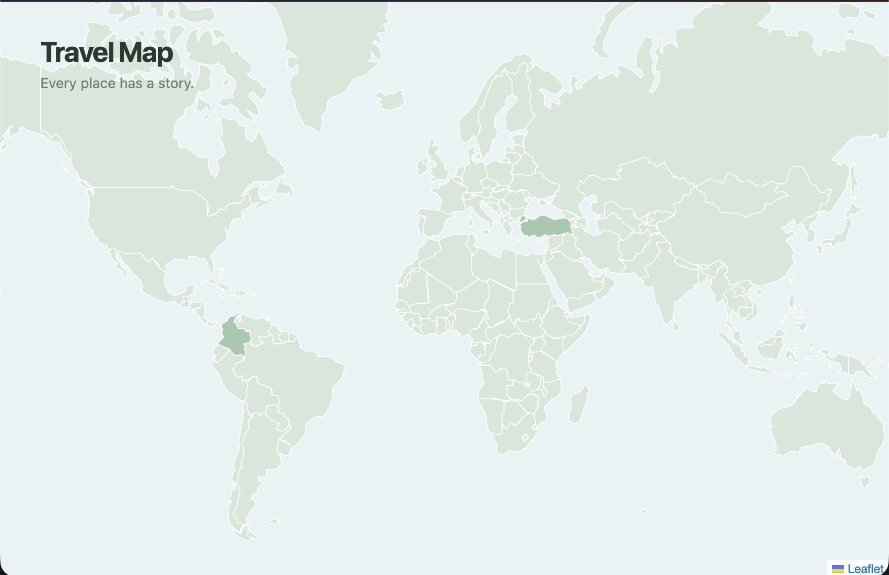
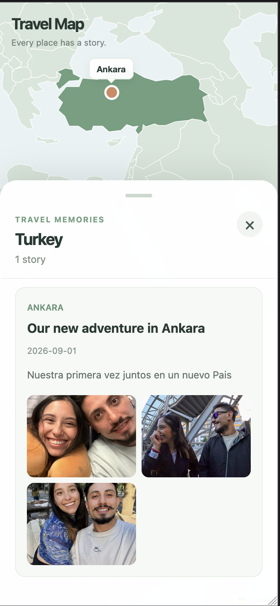

<div align="center">

# 🌍 Travel Map

### Every place has a story. Let's put yours on the map.

**An interactive, map-first travel journal for the places we've been and the memories we never want to forget.**

[🌐 Live demo](https://travel-map.jhonjaner11.workers.dev) · [🗺️ Roadmap](docs/ROADMAP.md) · [📸 Release gallery](docs/releases/)

   

</div>

> **A personal project with a bigger destination.** Travel Map began with a simple idea: the best souvenirs aren't things, they're stories. I wanted a more meaningful way to revisit the places I've explored with someone I love. The long-term vision is to let anyone create their own map of memories. Passport stamps optional. ☕

## ✨ See it in action

<!-- Add actual screenshots before publishing these image links. -->
<!--  -->
<!--  -->

**[Explore the live application →](https://travel-map.jhonjaner11.workers.dev)**

**Current prototype:** interactive world map, country selection and zoom, sample trip data, city markers, trip stories, photo galleries with a larger viewer, and a responsive mobile memories panel. The content currently demonstrates one personal travel journal; accounts and user uploads are not implemented yet.

## 🧭 The experience

1. **Explore the world:** pan and zoom around a clean, minimalist map.
2. **Pick a country:** highlighted countries indicate where memories have been added.
3. **Discover a place:** choose a city marker to focus on a trip.
4. **Relive the moment:** read its story and explore the photos.

No itinerary spreadsheet required.

## 🛠️ Built with

| Layer | Technology | Why |
| --- | --- | --- |
| UI | React + TypeScript | Reusable, typed components |
| Tooling | Vite | Fast local development and static builds |
| Mapping | Leaflet + React Leaflet | Interactive geography and map events |
| Geodata | Natural Earth GeoJSON | Custom country shapes and styling |
| Styling | CSS | Responsive map overlays, photo viewer, and mobile bottom sheet |
| Data (today) | Local TypeScript objects and static assets | A usable prototype without a backend |
| Hosting | Cloudflare | Public static deployment |
| Quality | ESLint + TypeScript build | Basic code-quality and compile checks |

### Under the hood

```text
React UI
  ├── WorldMap (countries, selection, geographic navigation)
  ├── CityMarkers (trip locations)
  ├── CountryMemoriesPanel (stories and mobile sheet)
  └── PhotoGallery (gallery and full-screen viewer)
         │
         └── Local trip data + image files
```

The initial version intentionally keeps the architecture lightweight. Geographic interactions, travel data, and UI presentation are separated so a future API can replace local data without rewriting the entire experience.

## 💻 Run locally

**Requirements:** Node.js version compatible with the Vite version specified in `package.json`, and npm.

```bash
git clone https://github.com/jcastellanos11/travel-map.git
cd travel-map
npm install
npm run dev
```

Open the local URL printed by Vite (typically `http://localhost:5173`). Replace `jcastellanos11` with the actual GitHub account before publishing this README.

```bash
npm run lint
npm run build
npm run preview
```

The prototype uses local trip records and images inside `public/`; it does not need API keys or a running backend.

## 🧪 Current scope and limitations

- **Single journal:** trip content is bundled with the site; visitors cannot save their own journeys yet.
- **No backend or authentication:** uploading, synchronization, privacy controls, and accounts are future features.
- **Maps and imagery:** geodata attribution and image rights must be respected. Only publish photos you have permission to share.
- **Early-stage product:** mobile interactions, accessibility, testing, and performance will continue to evolve.

## 🛣️ Where we're heading

| Stage | Direction |
| --- | --- |
| **Now — Interactive prototype** | World map, country and city exploration, stories, galleries, mobile layout |
| **Next — Better journeys** | Place-level memories, stronger map labels, accessibility, navigation polish, richer galleries |
| **Later — Multi-user platform** | Accounts, personal maps, upload and storage, public/private sharing |
| **Long-term — Sustainable product** | Collaborative travel journals and optional premium features, informed by user feedback |

See the [detailed roadmap](docs/ROADMAP.md). Plans are exploratory, not release promises.

## 📷 Following the journey

The README shows the current experience. Previous iterations, screenshots, and notable decisions live in [release notes](docs/releases/), starting with [v0.1.0](docs/releases/v0.1.0.md).

## ❤️ Why I built this

Travel Map started as a tribute to shared adventures and the person who makes them unforgettable. My hope is that it grows from our memories into a place where everyone can preserve their own — one pin, one picture, one story at a time.

*Built with curiosity, a love for software, and probably an unreasonable amount of coffee.* ☕

---

<div align="center">

**Made with ❤️ and TypeScript.**

</div>
