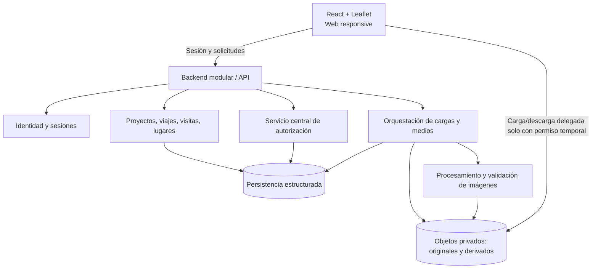

# Travel Map — Architecture Decision Study

**Versión:** 0.1 — comparativa para decisión, NO arquitectura aprobada  
**Fecha de verificación de proveedores:** 2026-11-01  
**Estado:** borrador para revisión; no selecciona backend, base de datos, mecanismo de autenticación ni proveedor de despliegue.  
**Fuentes de producto:** `docs/PRD.md` v1.0, `docs/DATA_MODEL.md` v0.1, `docs/AUTHORIZATION_MATRIX.md` v0.2 y auditoría de Codex `FRONTEND_AUDIT.md` (archivo original completo de la revisión).  
**Restricciones:** beta privada 3–5 usuarios; objetivo USD 0–10/mes; crecimiento gradual; reutilizar React/TypeScript/Leaflet; sin migrar datos estáticos antiguos.

## 1. Decisión solicitada y recomendación provisional

**Decisión por tomar:** elegir una implementación económica y mantenible de la API, identidad, persistencia, carga/procesamiento y lectura privada de fotografías, sin sacrificar el modelo de autorización ni los criterios de aceptación del PRD.

**Orientación provisional (NO aprobación):** monolito modular para las reglas de negocio; archivos privados separados de los datos estructurados; componentes adaptadores para identidad, persistencia y medios. Investigar primero una opción *TypeScript + Cloudflare Workers/D1/R2/Images* y mantener *TypeScript + Supabase Auth/PostgreSQL + Cloudflare R2/Images* como alternativa. *FastAPI* sigue siendo una opción técnica válida si una prueba demuestra que resuelve mejor el tratamiento de imágenes y el despliegue económico. La selección final depende de pruebas de concepto, particularmente privacidad + HEIC/EXIF + cuotas.

**Advertencia:** los límites gratuitos son cuotas, no promesas de disponibilidad ni garantía de gasto total. Servicios y precios pueden cambiar. Las estimaciones excluyen dominio, herramientas externas, impuestos y trabajo humano.

## 2. Requisitos arquitectónicos derivados

| ID | Restricción | Fuente/impacto |
|---|---|---|
| AR-01 | Separar `Project → Trip → Visit → Photo` y `Visit → Place` para futura consulta por país/ciudad entre viajes. | Modelo de datos aprobado conceptualmente; conservar visitas repetidas. |
| AR-02 | Servidor decide todos los permisos; invitado de viaje no ve otros viajes ni agregados. | PRD + matriz de permisos. |
| AR-03 | Original y derivados privados, con autorizaciones independientes de lectura y descarga. | PRD, auditoría de galería pública. |
| AR-04 | Google Sign-In, sin contraseñas locales en MVP; sesiones con revocación y limpieza de cachés. | PRD + auditoría. |
| AR-05 | JPEG/PNG/WebP/HEIC/HEIF hasta 20 MB cada una, 10 por operación; sugerencias EXIF con confirmación y derivados sin GPS. | PRD. |
| AR-06 | Cuota de 500 MB por usuario, contando originales, derivados y papelera; reservas y reintentos idempotentes. | PRD. |
| AR-07 | Papelera de fotografías, proyectos y viajes 30 días; manejo asistido para casos complejos; transferencias consentidas. | PRD + matriz. |
| AR-08 | Responsive 360/768/1440 px; primera vista útil con 100 visitas en objetivo de 4 s bajo perfil reproducible. | PRD no funcional. |
| AR-09 | Beta 3–5 usuarios; costo objetivo total USD 0–10/mes; no servidores siempre encendidos si pueden evitarse. | PRD y entrevistas. |
| AR-10 | Sin acoplar Leaflet a acceso directo a datos, estado de sesión o permisos. | Auditoría de Codex; `WorldMap` hoy importa `trips.ts`. |

## 3. Arquitectura lógica independiente del stack

**Significado:** módulos en un único backend desplegable cuando sea viable; el servicio de transformación puede ejecutarse por medio de una API administrada. La flecha directa entre navegador y almacenamiento **no** autoriza acceso abierto: requiere credenciales específicas, cortas y emitidas después de una verificación de permisos. Las descargas privadas también pueden pasar por el backend.

Responsabilidades internas (no microservicios obligatorios): `Identity`, `Projects`, `Trips`, `Visits/Places`, `Photos/Uploads`, `Memberships/Invitations`, `Quotas`, `Retention/Transfers`, `Audit/Operations`.

## 4. Comparación de backend

| Criterio | FastAPI (Python) | Node.js / TypeScript convencional | TypeScript en Cloudflare Workers |
|---|---|---|---|
| Modelo de dominio y API | Muy adecuado | Muy adecuado | Adecuado, verificar bibliotecas runtime |
| Compartir tipos con React | Contrato generado, no tipos nativos compartidos | Esquemas y tipos compartibles | Esquemas y tipos compartibles |
| Procesar EXIF y HEIC | Bibliotecas especializadas maduras; consume CPU/memoria | Bibliotecas maduras en Node; consume CPU/memoria | No asumir compatibilidad de bibliotecas Node nativas; preferir servicio Images administrado + prueba EXIF |
| Hosting económico | Host Python gratuito suele tener suspensión/recursos limitados | Igual en hosts convencionales; opción serverless según framework | Muy favorable para API ligera; CPU gratis limitada |
| Desarrollo local y portabilidad | Alto con ASGI estándar | Alto en servidor Node estándar | Adaptadores/bindings específicos requieren estrategia de migración |
| Riesgo principal | Disponibilidad/cold starts y procesamiento simultáneo en free tier | Costo del servicio always-on | 10 ms CPU en plan gratis, APIs Node parciales y complejidad de identidad propia |

No hay razón funcional para imponer *FastAPI* o *Node.js* antes de validar los escenarios críticos de medio y autorización. **Workers no es equivalente a un proceso Node.js convencional**: solo soporta un subconjunto de APIs de Node.

## 5. Escenarios de infraestructura a comparar

### Opción A — Plataforma Cloudflare integrada (candidato de costo mínimo)

- Frontend estático existente alojado en Cloudflare, sujeto a revisar configuración real.
- API TypeScript en Cloudflare Workers; módulos internos por dominio.
- D1 para persistencia relacional compatible con SQLite.
- R2 **privado** para originales y derivados.
- Cloudflare Images/Images binding para transformación HEIC a formato compatible y generación controlada de derivados.
- Google OAuth/OIDC con sesión propia correctamente validada (o librería compatible por investigar). Esta ruta **NO** proporciona un servicio de identidad administrado automáticamente.

**Ventajas:** pocas plataformas, costos bajos por uso, servicios escalables sin servidor permanente; Images puede procesar archivos de un bucket privado a través del binding sin hacerlos públicos.

**Riesgos/bloqueos:** implementar con seguridad OIDC, sesiones, rotación y revocación; CPU 10 ms en Workers Free; D1 usa semántica SQLite, exige prueba de atomicidad de cuota y migrabilidad; Images binding máximo **20 MB de entrada**, justo en el límite de archivo del PRD; se debe probar HEIC de iPhone y limpieza EXIF sin revelar originales. No dar por resuelta la extracción EXIF por el mero hecho de disponer de transformación.

**Costos publicados relevantes:** Workers Free 100.000 solicitudes/día, 10 ms CPU por solicitud; D1 Free 5 GB totales, **máximo 500 MB por base de datos gratuita**; R2 Standard Free 10 GB-mes, 1 millón operaciones clase A y 10 millones clase B al mes; Images Free 5.000 transformaciones únicas/mes. No incluye el costo de servicios adicionales si fueran requeridos.

### Opción B — Identidad/PostgreSQL administrados + API en Workers (candidato de menor complejidad de identidad)

- Frontend React existente.
- Supabase Auth con Google Sign-In + PostgreSQL administrado.
- API TypeScript en Worker con verificación de identidad y **autorización de dominio en servidor**.
- R2 privado y Cloudflare Images para medios, igual que en A.
- Políticas de acceso de base de datos coherentes con el modelo de acceso; validar si las consultas pasan por la API, por controles de fila o ambos; nunca confiar solo en React.

**Ventajas:** Google Auth administrado y modelo SQL PostgreSQL adecuado para integridad compleja, buen camino de migración a proveedores de PostgreSQL.

**Riesgos/bloqueos:** dos proveedores operativos; autenticación y backend cruzando redes, posible latencia, manejo de claves y políticas; Supabase Free se pausa luego de una semana de baja actividad (no apto como promesa de alta disponibilidad del portafolio). El paso a Pro tiene precio base superior al presupuesto objetivo.

**Costos publicados relevantes:** Supabase Free 500 MB DB, 50.000 usuarios activos mensuales, 1 GB Storage y 5 GB egress; Supabase Pro desde USD 25/mes. No se cuenta con el servicio de transformación Supabase Storage en el plan gratuito; en esta opción lo atendería Cloudflare Images.

### Opción C — FastAPI (o Node convencional) en Render Free + servicios de datos/medios

- Aplicación API convencional en Render Free (Python/Node) con Supabase Auth + PostgreSQL y R2 privado.
- Procesamiento de imágenes con librerías del servidor o servicio externo, según prueba de memoria/concurrencia.

**Ventajas:** mayor familiaridad con despliegue de API tradicional; amplio soporte para librerías de EXIF, procesamiento y validación.

**Riesgos/bloqueos:** Render Free se detiene tras 15 minutos sin solicitudes; el reinicio puede demorar alrededor de un minuto; disco efímero; bases de datos gratuitas de Render expiran tras 30 días, por lo que no deben albergar datos personales persistentes de la beta. La opción comercial Render desde USD 7/mes es posible en presupuesto **solo si** demás costos lo permiten; no resuelve por sí sola alta disponibilidad/retención de fotos.

### Opción D — Todo en Supabase Free (referencia de simplicidad)

- Auth, Postgres, Storage y funciones desde un proveedor.
- **No cumple por sí sola con la capacidad teórica aprobada**: 5 usuarios × 500 MB = 2,5 GB máximo de contenido, superior a 1 GB de Storage Free. El plan gratuito tampoco incluye transformación de imágenes; se requiere otro procesador o gasto adicional.
- Útil como prototipo recortado o para comparar operación, pero no se recomienda como implementación completa del PRD sin resolver esas limitaciones.

## 6. Costo y capacidad: escenario ilustrativo

| Supuesto de planificación (NO medición real) | Resultado |
|---|---|
| 3 usuarios con cuota de 500 MB cada uno | Capacidad autorizada agregada de hasta 1,5 GB, incluyendo derivados y papelera |
| 5 usuarios con cuota de 500 MB cada uno | Hasta 2,5 GB de contenido imputable; superior al 1 GB Supabase Storage Free |
| R2 Standard Free 10 GB-mes | Podría cubrir el máximo nominal de la beta y parte de respaldos/operaciones si el uso real se mantiene dentro del límite; requiere vigilancia |
| 15 fotos de ejemplo en repo | No migrarlas; nuevos perfiles parten vacíos |
| Cloudflare Images Free 5.000 transformaciones únicas/mes | Suficiente **como hipótesis** para la beta; probar si el procesamiento y el recuento por variantes cumplen los flujos |

El gasto real depende de bytes almacenados, copias internas, operaciones, tráfico, imágenes transformadas, dominios y servicios de reserva/alertas. Que el consumo inicial sea USD 0 **no garantiza** un costo estable de USD 0 al crecer. Configurar alertas/presupuestos y límites que bloqueen cargas antes de superar cuotas de proveedor cuando sea posible.

## 7. Autenticación y autorización: fronteras obligatorias

1. Google autentica a la persona; Travel Map mantiene `User`, roles, membresías, autoría y cuota propios. Identificar usuarios por ID estable de proveedor, **no por email mutable**.
2. Entrada privada a la API: validar sesión/credenciales, caducidad, revocación y ámbitos; aplicar matriz centralizada a cada recurso, conteo, filtro, miniatura y original.
3. Membresías de proyecto heredan acceso a todos sus viajes; invitado exclusivo solo obtiene un viaje. Comprobar en servidor aunque cliente conozca IDs de otros viajes.
4. Devolver capacidades de UI como ayuda visual, no como fuente de verdad. No enviar al navegador datos de otros proyectos para luego filtrarlos localmente.
5. Sesiones de cookies y tokens son alternativas a decidir; si se usan cookies, aplicar políticas SameSite/secure/CSRF/origen; si se usan tokens, diseñar almacenamiento, renovación y prevención de exposición. No fijar uno aún.
6. Invitaciones únicas de siete días: canje autenticado y atómico; tokens irreversibles almacenados como hash, revocación y prevención de doble canje.
7. Al cambiar membresía, cerrar sesión o eliminar cuenta: evitar que cachés privados de frontend/CDN expongan imágenes o conteos previos. Las URL firmadas son credenciales temporales que pueden seguir siendo válidas **hasta expirar**; no prometer revocación instantánea de bytes ya descargados.
8. R2 debe permanecer privado. Los derivados privados también requieren autorización. Cualquier imagen publicada después mediante enlace público debe tratarse como otro flujo de acceso.

## 8. Flujo conceptual de fotografías

**Flujo propuesto, no API aprobada:**

1. Usuario autorizado elige hasta 10 imágenes y solicita inicio de carga para `Visit` accesible.
2. Backend valida tipo, tamaño máximo, cuota restante y reserva cuota en forma segura ante concurrencia; emite identificadores de operación/archivo.
3. Upload a almacenamiento privado, directo con acceso acotado o a través de backend, bajo permisos por archivo. No usar prefijos públicos `frontend/public/images`.
4. Validar contenido binario y geometría de imagen; extraer sugerencias EXIF sin publicar coordenadas. El usuario confirma fecha/ubicación; una sugerencia no cambia automáticamente la `Visit`.
5. Procesar derivado optimizado (incluyendo HEIC si se suministra) y **comprobar que no contiene GPS ni metadatos sensibles**; conservar original bajo otra regla de autorización.
6. Marcar archivo disponible al finalizar los requisitos mínimos; contabilizar bytes de original + derivados. Fallos parciales permanecen reintentables sin duplicados; cancelar/liberar reservas fallidas.
7. Servir foto solo a actores autorizados; autor o administradores autorizados pueden descargar original si retienen permisos. Visor maneja expiración y cambios de acceso.
8. Papelera/retención y purga programada: 30 días de recuperación; respetar salvaguardas de otros autores y política de respaldos.

**Pruebas críticas:** archivo HEIC de 20 MB cerca del límite del Images binding; dimensiones extremas; EXIF GPS real; archivo malicioso/disfrazado; canje simultáneo de invitaciones; 2 cargas en paralelo cerca del límite de cuota; pérdida de acceso con visor abierto; 7 éxitos/3 fallos; borrado/restauración con ancestros archivados.

## 9. Persistencia y transacciones

- Proteger invariantes del modelo: `Photo` pertenece a `Visit`, `Visit` a `Trip`, `Trip` a `Project`, localidad `Place` consistente, identificadores estables; autorización se evalúa atravesando ancestros.
- Cuota: mantener una cuenta consistente de bytes usados + reservados. Comprobar y reservar capacidad **atómicamente**; confirmar bytes reales tras generar derivados; revertir o compensar fallos. No confiar en contadores del navegador.
- Cuando una cuenta se elimina, la transferencia de fotos conservadas requiere aceptación de nuevo responsable y capacidad; ninguna `Photo` persistente puede quedar sin responsable de cuota.
- En una misma ciudad pueden existir múltiples visitas (sin deduplicación por `Place`); la futura exploración por país/ciudad es una proyección autorizada, no copia de fotografías.
- Diseñar borrado lógico, fechas de eliminación, estados heredados, tareas de purga y reconciliación entre la DB y objetos; si falla una parte, ejecutar reintento/compensación verificable.
- Comparar pruebas de atomicidad en D1 frente a PostgreSQL antes de escoger. PostgreSQL ofrece restricciones/transacciones conocidas; D1 es relacional compatible con SQLite y tiene límites propios de base/gratis.

## 10. Adaptación del frontend (sin reescribirlo)

La auditoría de Codex identificó `WorldMap` importando datos desde `features/trips/data/trips.ts`; `Trip` equivale hoy a una visita urbana con fotos anidadas. `PhotoGallery` asume imágenes públicas y concatena `BASE_URL` a cada ruta. No hay auth, API client ni sistema de carga. El mapa/cartografía/galería son reutilizables como base, no como contrato de datos definitivo.

**Secuencia de integración propuesta:**

1. Crear adaptadores de datos independientes de Leaflet: `Project`, `Trip`, `Visit`, `Photo` con IDs estables, fechas opcionales y `Place` canónico.
2. Separar el coordinador de proyecto/viaje y consultas de `WorldMap`; usar estados de carga/error/vacío/prohibido.
3. Navegación para iniciar sesión, crear proyecto, elegir viaje y abrir una visita; una cuenta nueva empieza vacía.
4. Sustituir los paths públicos de galería por medios privados/autorizados, miniaturas, originales y estados de procesamiento.
5. Añadir cargas, reintentos y permisos. Invalidar datos privados y visor al perder acceso.
6. Verificar teclado, diálogo, foco, leyendas y navegación móvil 360/768/1440px; medir mapa con 100 visitas antes de optimizar.

## 11. Decisiones arquitectónicas abiertas (ADRs futuros)

| ID | Pregunta | Alternativas / criterio |
|---|---|---|
| ADR-001 | ¿Runtime de backend? | FastAPI; Node convencional; TypeScript Workers. Evaluar complejidad y cold starts. |
| ADR-002 | ¿Persistencia? | D1/SQLite o PostgreSQL administrado. Validar concurrencia, límites y migración. |
| ADR-003 | ¿Identidad/sesión? | Google OIDC gestionado por la app o Supabase Auth; definir cookies/tokens y revocación. |
| ADR-004 | ¿Medios? | R2 + Images binding/transform; alternativa con proceso Python/Node. Prueba privada HEIC+EXIF. |
| ADR-005 | ¿Carga privada? | URL firmada de corta duración vs proxy backend; analizar expiración y CORS. |
| ADR-006 | ¿Procesamiento/colas? | Sincrónico acotado, operación diferida con reintentos, servicio administrado; costo. |
| ADR-007 | ¿Respaldo/retención? | Política y restauración verificadas para DB + R2; respaldos internos no cuentan en cuota usuario. |
| ADR-008 | ¿Despliegue, observabilidad y alertas? | Configurar CI, entornos, secretos, registros, límites y costo; verificar Cloudflare hosting real. |

**Supuestos aún sin validar:** runtime real del prototipo en Safari/Android, viabilidad del procesamiento HEIC junto al límite de 20 MB, extracción EXIF de archivos iPhone, protección/invalidación de caché privada, D1 con reservas concurrentes, configuración real de Cloudflare de frontend y política de respaldo/retirada efectiva.

## 12. Pruebas de concepto obligatorias antes de elegir stack

| PoC | Experimento | Criterio de salida |
|---|---|---|
| POC-01: imagen privada | Subir archivo HEIC real de iPhone, conservar original privado, generar WebP sin GPS, mostrar solo a usuario autorizado. | Sin URL pública estable ni EXIF GPS en derivado; latencia/costo medidos y formato aceptado. |
| POC-02: cuota concurrente | Dos operaciones cercanas a 500 MB disponibles intentan reservar simultáneamente. | La suma usada+reservada nunca supera cuota; fallo no deja reserva huérfana. |
| POC-03: autorización de alcance | Invitado a Italia intenta abrir Colombia por API, miniaturas, original, conteos y mapa. | Todas las lecturas no autorizadas se rechazan; no se filtra en cliente. |
| POC-04: sesión e invitación | Google login, canje único y revocable, logout, solicitud con sesión inválida, URL firmada expirada. | Identidad estable, un solo canje exitoso, no acceso posterior por nuevos requests. |
| POC-05: costo/experiencia | 3–5 usuarios, fotos representativas, 100 visitas en perfil móvil 4G; reinicios y restauración. | Costo estimado dentro de USD 0–10/mes; mapa objetivo de 4 s y procedimiento de restauración demostrado. |

Estas pruebas son **spikes técnicos de validación** (se implementarán solo después de aprobar su alcance). No son autorización para modificar el frontend ahora.

## 13. Recomendación para la próxima conversación

1. Revisar este documento como estudio comparativo, no como decisión vinculante.
2. Elegir **una ruta principal de PoC y una alternativa**; aconsejable priorizar A vs B por el objetivo de costo, dejando C si procesamiento o portabilidad lo justifican.
3. Tras pruebas, registrar ADRs con argumentos y riesgos. Solo entonces pasar a `docs/API_CONTRACT.md` y `docs/IMPLEMENTATION_PLAN.md`.
4. Mantener `docs/PRD.md`, `DATA_MODEL.md` y `AUTHORIZATION_MATRIX.md` como fuentes de requisitos; actualizar estados cuando una decisión se apruebe. No inventar decisiones administrativas restantes.

## 14. Referencias de precios y capacidades (fuentes oficiales, consultadas el 2026-11-01)

- Cloudflare Workers pricing y límites: https://developers.cloudflare.com/workers/platform/pricing/ ; https://developers.cloudflare.com/workers/platform/limits/
- Cloudflare R2: https://developers.cloudflare.com/r2/pricing/ ; URL firmadas: https://developers.cloudflare.com/r2/api/s3/presigned-urls/
- Cloudflare D1: https://developers.cloudflare.com/d1/platform/pricing/ ; https://developers.cloudflare.com/d1/platform/limits/
- Cloudflare Images: https://developers.cloudflare.com/images/pricing/ ; https://developers.cloudflare.com/images/get-started/limits/ ; https://developers.cloudflare.com/images/optimization/binding/ ; metadata: https://developers.cloudflare.com/images/optimization/features/
- Supabase: https://supabase.com/pricing ; https://supabase.com/docs/guides/platform/billing-on-supabase ; https://supabase.com/docs/guides/auth/social-sign-in/auth-google ; https://supabase.com/docs/guides/storage/serving/image-transformations/
- Render: https://render.com/docs/free ; https://render.com/pricing
