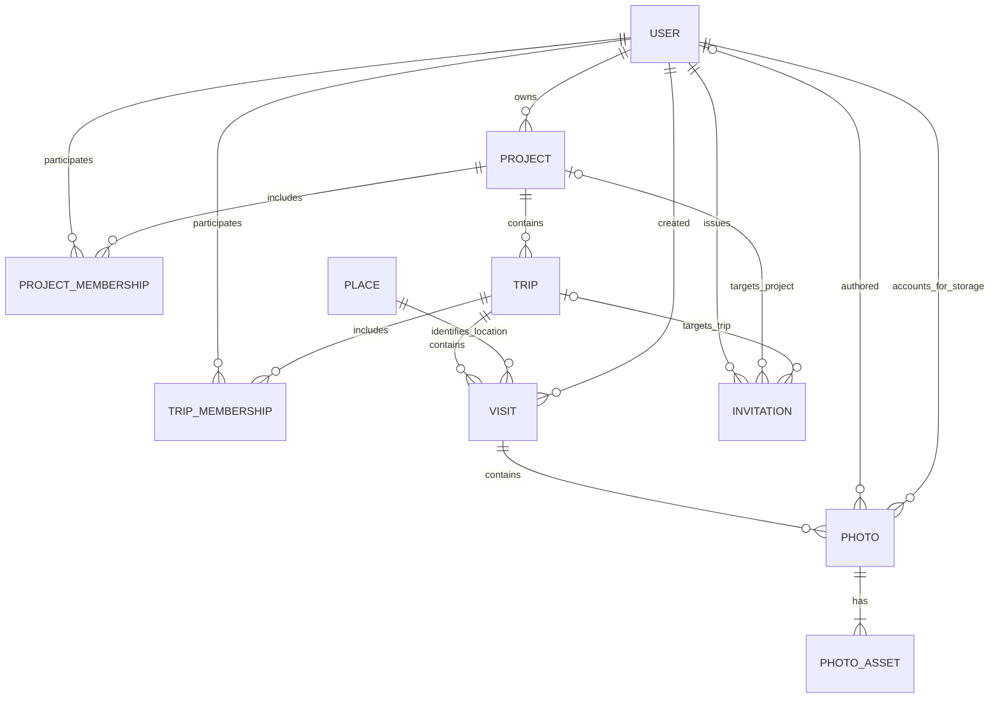

# Travel Map — Modelo conceptual de dominio

**Versión:** 0.1 (borrador para revisión)  
**Fecha:** 2026-11-01  
**Estado:** modelo conceptual de origen; las secciones de implementación E2.1–E2.3 al final documentan decisiones aprobadas y esquema real. Funcionalidad futura sigue siendo propuesta.
**Fuentes:** `docs/PRD.md` v1.0, auditoría de frontend de Codex (2026-11-01), decisiones de dominio #35 y #36 y modificación solicitada en la decisión #37.  
**Alcance:** modelo conceptual independiente de lenguaje, base de datos, ORM, API y proveedor cloud.

## 1. Objetivo y decisión de diseño

Travel Map organiza recuerdos según `Project → Trip → Visit → Photo`. Una visita es **compartida** entre colaboradores autorizados, mientras cada fotografía conserva su autor y responsable de almacenamiento. Las visitas repetidas a una misma ciudad no se fusionan.

**Modificación de la decisión #37:** el modelo también debe permitir, en una versión futura, consultar **todas las fotografías asociadas a Colombia o a una ciudad concreta**, aunque pertenezcan a distintos viajes y proyectos. La búsqueda debe limitarse a los recursos **autorizados para el usuario**. Esto no amplía por sí solo la interfaz del MVP: el mapa general por proyecto y sus filtros sí pertenecen al MVP; un explorador geográfico transversal entre proyectos queda preparado en el modelo y propuesto para el roadmap.

**Principio:** las fotografías no se copian ni se trasladan para aparecer en una vista geográfica transversal. La ubicación normalizada de cada `Visit` permite consultar sus `Photo` y mantener el vínculo original con `Trip` y `Project`.

## 2. Lenguaje del dominio

| Concepto | Definición |
|---|---|
| `User` | Cuenta y principal de identidad y permisos. |
| `Project` | Espacio individual o colaborativo; contiene viajes y un propietario principal. |
| `Trip` | Viaje perteneciente a un solo proyecto. |
| `Visit` | Registro compartido de una visita a un lugar dentro de un viaje, con fechas opcionales. |
| `Place` | Referencia **geográfica normalizada** y reutilizable para identificar una ciudad/localidad dentro de un país; no pertenece a un proyecto ni a un viaje. |
| `Photo` | Aporte fotográfico con identidad propia, vinculado a una sola visita, con autoría y descripción. |
| `PhotoAsset` | Archivo original o derivado técnico correspondiente a una fotografía. |
| `ProjectMembership` | Participación de un usuario en un proyecto, con rol y permisos derivados. |
| `TripMembership` | Acceso particular a un viaje, sin conceder acceso al proyecto completo. |
| `Invitation` | Invitación controlada a un proyecto o viaje. |
| `StoragePolicy` / `UploadOperation` / `StorageTransfer` | Responsabilidades operativas para límites, reintentos y transferencias; no implican necesariamente tablas independientes. |

## 3. Relaciones conceptuales

**Lectura del diagrama:** una fotografía puede perder su referencia personal de autor tras la eliminación consentida de la cuenta, pero **no** puede quedar sin un responsable de cuota mientras permanezca almacenada. `Invitation` tiene exactamente **uno** de los dos ámbitos de destino (proyecto o viaje); el diagrama representa ambas relaciones posibles, no simultáneas. `PhotoAsset` puede no estar completo mientras la fotografía se procesa.

## 4. Entidades y atributos conceptuales

Los identificadores son estables y opacos. Los atributos enumerados indican información de negocio; no fijan nombres de columnas ni formatos de persistencia.

| Entidad | Atributos principales | Restricciones |
|---|---|---|
| `User` | `id`, nombre visible, email, identificador de Google, estado de cuenta | La identidad estable del proveedor no depende del email; no hay contraseñas locales en MVP. |
| `Project` | `id`, nombre, `ownerUserId`, política de creación de viajes, estado y fechas de ciclo de vida | Exactamente un propietario válido por proyecto activo; cambios de titularidad controlados. |
| `Trip` | `id`, `projectId`, nombre, descripción opcional, estado | Un viaje pertenece a un solo proyecto. |
| `Place` | `id`, código de país normalizado, nombre de localidad, región administrativa/desambiguación, nombre visible, coordenada de referencia aproximada, referencias externas opcionales | No representa GPS privado. Un identificador estable diferencia ciudades homónimas y alias. |
| `Visit` | `id`, `tripId`, `placeId`, `createdByUserId`, nombre de lugar concreto opcional, punto exacto confirmado opcional, precisión/consentimiento de visualización, modo de fecha, fechas, estado | Una visita pertenece a un viaje y referencia una localidad válida. Distintas visitas pueden apuntar al mismo `Place`. |
| `Photo` | `id`, `visitId`, autor actual si existe, `quotaResponsibleUserId`, descripción opcional, estado, marcas de creación/eliminación | Una fotografía pertenece a una sola visita; el responsable de cuota debe existir si la foto se conserva. |
| `PhotoAsset` | `id`, `photoId`, variante (original/derivado), formato, tamaño contabilizable, estado, referencia privada al archivo | No exponer credenciales ni rutas públicas permanentes. |
| `ProjectMembership` | usuario, proyecto, rol de administrador/miembro, estado | El propietario se determina desde `Project` para evitar dos fuentes de verdad. |
| `TripMembership` | usuario, viaje, rol de acceso, estado | Solo otorga acceso al viaje de destino; ser miembro del proyecto ya da acceso heredado. |
| `Invitation` | `id`, emisor, ámbito y destino, estado, fecha de expiración, uso/revocación, destinatario opcional | MVP: enlaces autenticados, de un solo uso, revocables, siete días de vigencia inicial. |

**Nota de consistencia:** `Photo` puede tener un autor histórico anonimizado al borrar la cuenta; el autor no debe convertirse en una referencia inválida. Mientras la cuenta exista, se mantiene la autoría. La atribución y la obligación de cuota son conceptos independientes.

## 5. Ubicación geográfica y exploración transversal

### 5.1 Identidad de lugar

- Un `Place` identifica la **localidad**, no una visita concreta ni la dirección exacta de una fotografía.
- `Place.countryCode` permite consultar todo un país; `Place.id` permite consultar una ciudad concreta. No se debe agrupar solo por el texto `"Bogotá"`: hay nombres repetidos, variantes idiomáticas y cambios de nombre.
- Un código de país canónico estable (por ejemplo, `COL`) y la localidad/región diferenciada permiten integrar los mapas actuales y una futura fuente de búsqueda de lugares. El proveedor y el sistema definitivo de identificadores aún no están seleccionados.
- Los nombres de presentación y alias pueden cambiar sin cambiar la identidad de una visita. La ciudad debe distinguirse de una región administrativa (por ejemplo, el departamento del Meta no es una ciudad).
- La coordenada aproximada del `Place` permite dibujar un marcador cuando la visita no tiene un punto exacto. El punto exacto confirmado, si existe, se mantiene **en `Visit`**, con su regla de privacidad, no en el catálogo global público.

### 5.2 Qué significa «fotografías tomadas en un lugar»

En la versión inicial, una foto se considera localizada en el `Place` de la **visita a la que fue asociada por el usuario**, no por datos GPS EXIF inferidos de forma automática. Una sugerencia EXIF debe confirmarse antes de actualizar la visita. Las fotos hechas realmente en otra ciudad deben asociarse a una visita de esa ciudad para aparecer en la búsqueda correcta.

**Extensión posible, no aprobada para MVP:** ubicación confirmada a nivel de foto distinta de la visita. Se evaluará si usuarios necesitan buscar fotos por el punto individual de captura; no se almacenará automáticamente GPS preciso para habilitarla.

### 5.3 Consultas conceptuales

| Vista | Alcance | Criterio geográfico |
|---|---|---|
| **MVP: mapa de proyecto** | Solo viajes visibles del proyecto seleccionado | País/ciudad a través de `Visit → Place`; filtros de viaje, país y fechas. |
| **MVP: viaje individual** | Solo viaje autorizado | Visitas y fotografías del viaje. |
| **Futuro: todas mis fotos de Colombia** | Unión de viajes de proyectos autorizados **y** viajes a los que el usuario fue invitado de manera individual | `Place.countryCode = COL`, sin depender del nombre o ID del viaje. |
| **Futuro: todas mis fotos de Bogotá** | Mismo alcance autorizado | Identificador(es) canónicos pertinentes de `Place`, desambiguados por país/región. |

**Ejemplo:** `Colombia 2025 → Bogotá → Photo A` y `Vacaciones 2027 → Bogotá → Photo B` conservan dos `Trip`, dos `Visit` y dos `Photo`. Ambas visitas refieren al mismo `Place` Bogotá, Colombia. El explorador futuro puede mostrar A y B en una sola galería, junto con el contexto de proyecto, viaje y visita, **sin duplicar fotos ni fusionar visitas**.

**Privacidad e integridad de la consulta:** resolver autorización **antes de contar, paginar, devolver miniaturas o presentar facetas**. Un invitado exclusivamente a un viaje verá solo las fotos de ese viaje, incluso si busca todo Colombia. Se excluyen por defecto las fotografías borradas y los recursos archivados o pendientes de eliminación; toda excepción de visualización debe estar autorizada. Si una misma fotografía se alcanza mediante varios caminos de autorización, debe aparecer una sola vez por su `Photo.id`. Una segunda carga intencional del mismo archivo es otra foto y puede aparecer como tal.

El explorador global entre proyectos es **capacidad futura**: preparar identificadores y relaciones ahora, sin introducir su interfaz, endpoints ni costos de agregación en el MVP.

## 6. Tiempo, visitas y fotos

- Una `Visit` puede registrar **sin fecha**, **una fecha** o **un intervalo completo**; fechas de calendario, sin conversión que cambie el día por zona horaria.
- Un rango debe tener inicio no posterior al fin. Un filtro temporal incluye visitas cuyos intervalos **se superponen** con el intervalo solicitado; visitas sin fecha se omiten del resultado filtrado por fecha, pero aparecen en el mapa general.
- Varias visitas a una ciudad son válidas en un viaje, aunque coincidan en fechas. No se fusionan por nombre, ubicación ni proximidad.
- Una visita puede existir con **cero fotografías**. Varias personas autorizadas pueden aportar fotos a la misma visita. Cada foto pertenece a una sola visita.
- Las fechas capturadas desde EXIF son sugerencias, no fuente autoritativa; su aplicación requiere confirmación. Una fecha propia de cada foto sería una ampliación a documentar si se necesitara para búsquedas individuales.

## 7. Acceso, autoría y colaboración

- **Propietario:** un único `Project.ownerUserId` por proyecto activo; puede transferir propiedad. Los privilegios del propietario se derivan de esta relación, no de un rol duplicado.
- **Administradores de proyecto:** gestionan el proyecto, participantes y contenido dentro de su ámbito, de acuerdo con la política aprobada.
- **Miembros de proyecto:** heredan visibilidad y posibilidad de aportar fotografías en todos sus viajes. La creación de viajes depende de la configuración del proyecto.
- **Miembros invitados a viaje:** pueden acceder y colaborar en ese viaje, no explorar otros viajes del proyecto ni datos agregados privados del proyecto.
- **Visitas:** los participantes autorizados pueden crearlas y añadir fotos; solo el creador de la visita y los administradores autorizados pueden cambiar la ubicación, fechas o solicitar eliminación de esa visita (decisión #36).
- **Fotografías:** el autor puede gestionar sus fotos mientras tenga acceso, y los administradores autorizados pueden gestionarlas en su ámbito. Para una persona que salió del proyecto se habilita procedimiento para solicitar retirada de sus aportes sin reabrir el acceso al resto del viaje.
- La consulta geográfica global no concede permisos adicionales: es una **proyección sobre recursos ya autorizados**, no una biblioteca pública ni un nuevo tipo de membresía.

Toda operación sobre un identificador o archivo privado se autoriza en el backend. Los permisos que muestre la interfaz son únicamente orientación para la experiencia de usuario.

## 8. Archivos, cuotas y cargas

- `Photo` identifica el recuerdo; `PhotoAsset` distingue original privado de uno o varios derivados optimizados. No se garantiza una versión visible hasta finalizar el procesamiento requerido.
- Límite inicial configurable: **10 fotografías por carga**, **20 MB por archivo**, **500 MB por usuario**. La cuota incluye originales, derivados y papelera; los respaldos internos no se imputan.
- El responsable de cuota es inicialmente quien sube la fotografía. Si abandona un proyecto, las fotografías permanecen y siguen consumiendo su cuota mientras conserve la cuenta.
- Al eliminar la cuenta, las fotos conservadas requieren aceptación de un nuevo responsable con capacidad suficiente; se desvincula la atribución personal del usuario eliminado. No debe existir una foto conservada asociada a una cuota inexistente.
- `UploadOperation` diferencia reintentos de una misma carga de una subida intencional nueva. Debe permitir éxito parcial, limpieza de fallos y contabilización correcta bajo concurrencia; el mecanismo técnico de idempotencia queda pendiente.
- EXIF sirve para **sugerir** ubicación/fecha; los derivados deben excluir metadatos sensibles y no revelar coordenadas exactas sin consentimiento.

## 9. Estados, archivado, papelera y eliminación

| Recurso | Estados conceptuales relevantes | Regla |
|---|---|---|
| `User` | activo, solicitud de eliminación, eliminado | No eliminar cuenta con propiedad de proyectos o cuotas sin resolver. |
| `Project` | activo, archivado, pendiente de eliminación, eliminado | Archivado conserva datos; eliminación recuperable 30 días y salvaguardas para aportes ajenos. |
| `Trip` | activo, archivado, pendiente de eliminación, eliminado | Hereda el ámbito del proyecto y protege fotos aportadas por terceros. |
| `Visit` | activo, pendiente de eliminación, eliminado | Propuesta: ocultar junto con sus fotos, con 30 días de recuperación y salvaguardas de autoría. |
| `Photo` | pendiente de procesamiento, disponible, fallo, papelera, purga | Papelera durante 30 días; se conserva la cuota hasta purgar los archivos. |
| `Invitation` | pendiente, aceptada, vencida, revocada | Aceptación única y acceso solo después de autenticar. |

La eliminación de un recurso padre no debe destruir inmediatamente los archivos de sus hijos. La visibilidad efectiva de una foto depende **también** del estado del proyecto, viaje y visita. Restaurar exige que los padres estén vigentes y que el solicitante posea permisos. La eliminación definitiva de fotografías ajenas necesita aviso y un procedimiento de conservación o descarga según el PRD; los detalles operativos se definirán en autorización/ciclos de vida.

## 10. Invariantes de integridad

1. `Trip` pertenece exactamente a un `Project`; `Visit` exactamente a un `Trip`; `Photo` exactamente a una `Visit`.
2. `Visit.placeId` remite a una localidad válida; sus datos de país y ciudad no pueden contradecirse.
3. Dos visitas pueden compartir `placeId`, incluso dentro del mismo viaje: la identidad de visita nunca es el nombre de la ciudad.
4. `Photo.author` (si la cuenta sigue activa) y `Photo.quotaResponsible` son responsabilidades distintas; ninguna foto retenida queda sin cuota asignada.
5. Un proyecto activo siempre tiene propietario vigente; la transferencia debe ser coherente antes de salida o eliminación de cuenta.
6. Una invitación apunta a un solo recurso de destino, se canjea como máximo una vez y no puede otorgar permisos fuera de su ámbito.
7. Un reintento de la misma operación de carga no duplica fotos ni cuota; una subida nueva intencional sí puede generar otro recurso.
8. El acceso se determina por membresías válidas y estados del recurso; la ubicación compartida jamás sustituye a la autorización.
9. Ni conteos, ni filtros, ni miniaturas, ni resultados transversales pueden incluir recursos fuera del alcance autorizado.
10. El borrado recuperable preserva información suficiente para restauración y debe respetar los plazos de conservación y la política de respaldos.

## 11. Casos de aceptación del modelo

| ID | Escenario | Resultado esperado |
|---|---|---|
| DM-01 | Dos viajes distintos registran visitas a Bogotá. | Existen dos visitas independientes con un mismo `Place`; sus fotografías no se fusionan en origen. |
| DM-02 | Un usuario autorizado busca Colombia en el futuro explorador global. | Aparecen fotos de **todos sus viajes autorizados** asociados a localidades colombianas, sin duplicar registros por permisos superpuestos. |
| DM-03 | Un invitado solo a Italia busca o intenta acceder a fotos de Colombia en otro viaje privado. | No recibe archivos, miniaturas, metadatos, conteos ni detalles del viaje ajeno. |
| DM-04 | Se sube una foto sin GPS EXIF a una visita de Bogotá. | La foto puede recuperarse por Bogotá/Colombia debido a la visita confirmada; no requiere GPS. |
| DM-05 | Una visita se crea sin fechas ni fotografías. | Es válida y aparece en mapas generales autorizados; se excluye de filtros temporales activos. |
| DM-06 | Dos fotos iguales se suben en operaciones nuevas e intencionales. | Son `Photo` independientes; un reintento de la **misma** operación no crea una tercera. |
| DM-07 | La persona que aportó fotos abandona el proyecto. | Se mantienen en la visita, con cuota a su cargo, pero la persona no recupera acceso al resto del proyecto. |
| DM-08 | Se solicita eliminar una visita con fotos de varios autores. | La visita se oculta; la recuperación y la protección de aportes ajenos preceden la purga definitiva. |
| DM-09 | Se conserva una foto tras la eliminación de la cuenta del autor. | La cuota se transfiere por aceptación, la atribución personal se desvincula y el archivo continúa con acceso protegido. |
| DM-10 | Dos localidades comparten nombre, o una localidad tiene variantes de nombre. | Se distingue el lugar por su identidad geográfica, no solo por la etiqueta visible. |

## 12. Dependencias y decisiones diferidas

**Pendientes de diseño técnico, no bloquean el modelo conceptual:** origen/catálogo de lugares y correspondencia de códigos geográficos; precisión y consentimiento para coordenadas; contrato de consultas paginadas y autorizadas; autenticación y medios privados; almacenamiento y procesamiento; atomicidad de cuotas y transferencias; operaciones de purga y respaldo; forma física de persistir entidades operativas.

**Pregunta de producto pendiente para una versión futura:** ¿una fotografía debe poder tener una ubicación geográfica propia, distinta de su `Visit`? De momento, la vista por país/ciudad utiliza la ubicación **confirmada de la visita**. Esta definición debe quedar visible al usuario para evitar que «foto tomada en» sugiera precisión EXIF no confirmada.

**Control de cambios:** el `docs/PRD.md` v1.0 aprobado define el MVP por proyecto y no el explorador global entre proyectos. Al aprobar este modelo, conviene agregar a una próxima revisión del PRD un requisito de **exploración geográfica transversal futura** y sus criterios de autorización, **sin incorporarlo automáticamente al MVP**.

## 13. Próximo entregable

Tras aprobar este borrador: `docs/AUTHORIZATION_MATRIX.md` (roles por ámbito, acceso a fotos, recuperación, revocación y transferencia); después, comparación arquitectónica y contrato de API. Ninguna elección de stack está implícita aquí.

## E2.1 implementation note — 2026-11-04

Migration `0003_trips_authorization` implements `trips` and guest-only `trip_memberships`. Project/creator/guest-user references use RESTRICT; retained content is not cascade-deleted. Project membership inheritance is resolved at request time, not copied into Trip memberships. Trip creator is immutable API provenance, not an editing grant: approved P-03 Option A reserves name/description edits to Project Owner/Admin. Lifecycle storage exists, but lifecycle mutation and membership-administration APIs remain deferred. This decision does not change future Visit creator/Admin editing rules. Exact schema and evidence: [E2.1 validation](../backend/E2_1_VALIDATION.md).

## E2.2 implemented model — 2026-11-04

Migration 0004 adds private owner-controlled `country_codes` (alpha-3), `places` and `visits`. Geographic catalog identity is independent of user data: stable UUIDv5 derived from GeoNames source URLs, optional scoped provider/source identity, country FK, locality, optional region and independent approximate WGS84 pair. City name is never unique. The initial controlled catalog is six localities across COL/TUR/USA; region is the source admin1 code. Provenance, transformations, CC-BY-4.0 attribution and limitations: [catalog](../backend/catalog/README.md). It is not worldwide coverage or a definitive provider selection for all future geography.

Visit has immutable API trip/creator associations, mutable explicit placeId, optional nullable name (no description field in this increment), `date_mode/date_start/date_end`, lifecycle and UTC operational timestamps. Dates are PostgreSQL DATE, serialized directly as YYYY-MM-DD; none has null boundaries, single has equal dates, range has both ordered dates. Repeated Place/Trip/date combinations remain distinct Visit rows. All retained-content FKs are RESTRICT; no deletion/trash/restore endpoints exist.

D1/D2/D3 are approved. Exact-point columns exist only as a fail-closed future boundary: a database constraint requires coordinate/confirmation/visibility fields all null. API accepts confirmedCoordinates only as null and never returns a precise point. Enabling storage/sharing requires a separately approved confirmation, visibility/reconfirmation and revocation policy plus a later migration; authorship or a claimed client confirmation alone is insufficient. No EXIF is processed. Independent approximate Place points are never overwritten from Visits.

Creator editing requires current Trip access; O/A may edit within their active Project. Other Members/Guests cannot edit another author’s Visit. This does not change P-03’s Owner/Admin-only Trip editing rule. Inactive ancestors/grants hide retained contributions. Map DTO is one marker per authorized Visit, not a merged city/travel record; photoCount=0 and previewPhotoId=null. Full implemented request/response shapes: [API contract](API_CONTRACT.md#e22-implemented-geography-contract-2026-11-04).

## E2.3 approved decisions — 2026-11-05

Recorded before E2.3 implementation from explicit user approval:

- **P-02b Option A:** Owner and active Project Admin may edit only ordinary Project name and the existing admins_only/all_project_members Trip creation policy. Ownership, lifecycle and role assignment are excluded. Only Owner appoints/removes Admins and archives.
- **Project departure Option A:** Project removal/self-departure atomically revokes the active Project membership and every active explicit descendant Trip grant, while preserving content, creator attribution and future storage responsibility. Owner cannot leave. Existing descendant grants cannot restore access; future new authorization is outside this increment.
- **P-01b Option B:** Owner and Admin may restore archived Projects in a future approved workflow. **No restoration endpoint or shortcut is authorized in E2.3.** Owner-only archive currently has no implemented self-service restoration.

E2.3 only is authorized; E2.4 invitations and ownership transfer remain out of scope.

### E2.3 implemented schema and transitions

Migration 0005 reuses Project/Trip memberships and Project lifecycle without changing
0001–0004. Owner remains `projects.owner_user_id`. Dedicated operations change
Member↔Admin or active→revoked; no membership issuance/reactivation API exists yet.
Departure includes every explicit descendant grant, preserving authored Trips and
Visits and their creator foreign keys. Project active→archived retains all children
and grants. No reverse lifecycle API is implemented.

`domain_audit_events`: UUID PK, actor FK to users (RESTRICT), resource UUID/type
(project/trip), closed action enum, UTC occurred_at, server-built minimal JSON
transition metadata. Resource identity is polymorphic; private handler supplies the
verified locked Project/Trip ID (no client audit-writing interface). Actor/resource
indexes support future operational lookup. Table has FORCE RLS/owner-only policy,
no runtime table grants. UPDATE/DELETE/TRUNCATE triggers reject rewrites, including
normal owner DML. This is not tamper-proof storage against a privileged owner able
to change DDL. No audit reader endpoint; retention/export policy remains pending.
No names, emails, raw bodies, credentials, session digests, GPS or invitation secrets
are recorded. Audit and domain mutations commit/rollback together.

## E2.4 approved decisions — 2026-11-05

Recorded before implementation: P-08 Option A preserves all existing effective
permissions without duplicate memberships or role changes. Existing-access redemption
consumes the single-use invitation and returns already_has_access; subsequent replay
is invalid, including after membership removal. P-09 Option A permits Trip-only
context, never private Project details/other Trips/maps/counts/settings/rosters.
P-10 Option A permits only author IDs relevant to visible content, no participant
roster, emails or hidden profiles. Invitations grant Member or Trip Guest only.
A fresh valid invitation explicitly authorizes rejoining as Member/Guest; consumed
links never restore revoked access. Issuer-authority persistence is still unspecified:
conservative validation requires current Owner/Admin authority at redemption.

### E2.4 implemented schema

0006 adds invitations (UUID; exactly-one Project/Trip RESTRICT FK; unique SHA-256
digest; issuer RESTRICT FK; creation/expiry; paired redemption/revocation actor and
time). Pending/consumed/revoked are derived from timestamps; expiration is checked
against database time. Constraints exclude simultaneous consumption/revocation.
invitation_attempts is one bounded per-account counter/window, not a request log.
Both tables FORCE RLS, owner-only policies, no runtime access. Audit action constraint
is extended for issuance/revocation/redemption; metadata remains empty for these
actions. Existing audit rows and append-only triggers are preserved.
Down is disposable-only, restores dispatcher and old audit action rules NOT VALID
so historical invitation events survive without rewriting append-only records. New
writes still obey old rules. Membership effects are never undone by migration down.

## E4.1 implemented SQL/domain foundation — 2026-11-08

Migration0007 introduces Photo, PhotoAsset/artifact journal, UserMediaQuota,
UploadOperation, FileSlot, QuotaReservation, ProcessingAttempt and MediaTask/outbox.
This is validated only in disposable PostgreSQL; no persistent migration or media
HTTP/storage/processing implementation. Photo has immutable Visit/creator and separate
quota responsibility (initially the same contributor, not transferable here).
All FKs RESTRICT; all eight private tables FORCE RLS with owner-only policies.

Binding beta update: all retained archival/display/thumbnail images must be sanitized
reconstructions; no byte-identical/raw original or EXIF/GPS/date suggestions. Opaque
keys are private technical references. Decimal limits are10 files,20000000 input bytes,
500000000 charged/reserved bytes per user and2592000seconds trash retention. HEIC/HEIF
remain disabled pending portable-codec/containment proof. Earlier E4 examples are
superseded for these fields; no precise location columns/features are added.

Reservation finalization, fencing, cleanup and trash/purge/restore transitions are SQL
foundations with restricted synthetic evidence tests. Actual object verification
remains future work; SQL is not an object-store transaction. Maintenance audit events
have explicit technical attribution and no fake user. Existing audit history and
append-only controls remain intact. [Exact model/security](../backend/src/modules/media/README.md),
[contract](E4_MEDIA_CONTRACT.md), [validation](../backend/E4_1_VALIDATION.md).
