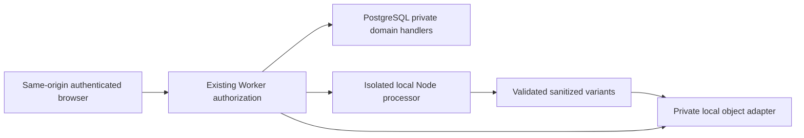

# E4.0 — Private media architecture proposal

Date: 2026-11-08. Baseline: `main`, `0f399bd` (E3.5 committed). **Research only;
no E4.1 implementation or acceptance.** Status labels describe evidence, not approval:
Verified, Partially verified, Unverified, Blocked, Not supported.

## Authority and repository findings

**Verified.** Existing routes/configuration, migrations 0001–0006, current OpenAPI,
PRD, ADR-001, architecture/data/authorization/API plans, E2 plan, E3.5 validation,
backend security and frontend Visit/gallery implementation were inspected. The only
pre-existing working-tree change was `backend/supabase/config.toml`; it is preserved.
No application source, configuration, migration, OpenAPI, dependency or lockfile is
changed by E4.0. No persistent database was accessed by the PoC.

| Existing evidence | Implication |
| --- | --- |
| `backend/src/app.ts`, `src/modules/identity/security.ts`, `src/infrastructure/postgres.ts` | Keep same-origin HTTPS, opaque sessions, Origin/CSRF and safe RPC/error handling |
| `backend/migrations/0002_identity.up.sql`, `0003`–`0006` up/down SQL | Runtime surface remains `oauth_begin`, `oauth_consume`, `login_complete`, `api_call`; private handlers, fixed SQL paths, ownership/ACL checks and FORCE RLS remain authoritative |
| `0006_invitations.up.sql: api_call`, `backend/src/modules/geography/types.ts` | `/me` currently reports zero used/reserved and 500,000,000 quota bytes; geography truthfully reports zero photos/null previews; no implemented media contract |
| `backend/src/env.ts`, `backend/wrangler.jsonc` | No production R2 or Images binding; nodejs_compat and compatibility date 2026-10-30; local HTTPS port 8789 |
| `frontend/src/private/visits/TripVisits.tsx`, `frontend/src/private/controller.ts` | Preserve Trip ancestry, current-access checks, cancellation and private-state cleanup |
| `frontend/src/features/trips/components/PhotoGallery.tsx: getPhotoUrl` | Demo gallery concatenates public BASE_URL paths; private gallery requires a separate authenticated-media adapter, not private files copied to public assets |

**Approved for this research:** all media private; Visit parent; batch ≤10; file ≤20 MB;
user quota 500 MB including all variants, trash and reservations; trash 30 days;
retained contributions after departure; author/current authorized administrators manage
content. Strip GPS from **every** stored image, including archival. No precise-GPS
feature. No R2/Images activation.

Older PRD/API/architecture text refers to retaining original bytes and EXIF suggestions.
The explicit E4.0 instruction supersedes that media proposal for the initial beta:
retain **a sanitized archival reconstruction**, never unsanitized originals, never
EXIF date/location suggestions. Historical documents are not rewritten as implemented
behavior. Formal E4.1 contract review must reconcile this terminology. Visit calendar
dates and approximate catalog points remain unchanged.

## Recommended local architecture and runtime boundary

**Recommendation; end-to-end integration Unverified.** Keep domain authorization and
quota transactions in the existing Worker/PostgreSQL modular monolith. Introduce small
internal ObjectStore and ImageProcessor ports, with independently testable adapters.



No arrows above represent implemented application integration. A local processor
boundary needs an authenticated, bounded, non-public transport and a job-authority
decision before implementation. It must not accept arbitrary file paths, URLs or
client storage keys. Do not add a publicly reachable filesystem server.

**Verified:** Node Sharp processes JPEG/PNG/WebP locally. **Not supported:** the
installed native Sharp addon inside workerd (`process.dlopen` is not implemented).
Workerd cannot read the generated host marker. Its `/tmp` works within a request but
did not persist to the next request. Cloudflare documents a virtual, memory-backed
filesystem, not durable host disk. [Workers fs](https://developers.cloudflare.com/workers/runtime-apis/nodejs/fs/)

Use the existing local Wrangler R2 emulator as the preferred future **development**
Worker-facing storage adapter, with persistence explicitly outside every asset root.
That is local emulation, not a real bucket. E4.0 tested only a separate spike binding,
not application configuration. The Node filesystem experiment proves an alternative
adapter's mechanics; it cannot simply be imported into the Worker. A future local
Node processor can own private scratch/output storage, but its bridge remains an
E4.1/E4.2 design gate. This preserves the approved production stack instead of
pretending Node host APIs exist in Workers.

For later cloud processing, evaluate the already selected Images adapter only after
separate sandbox approval. Local Images transforms run through emulator machinery;
they are not evidence of native decoding inside the isolate or hosted behavior.
An additional hosted Node/HEVC service would add patching, isolation, privacy, network
and operating costs and requires separate architectural approval.

## ObjectStore contract and isolation

Proposed internal interface (not an HTTP API):

```ts
interface ObjectStore {
  putIfAbsent(key: OpaqueKey, source: ReadableStream<Uint8Array>, options: {
    knownLength: number; maxBytes: number; sha256: string; contentType: SafeRasterType;
  }): Promise<VerifiedObjectMetadata>;
  get(key: OpaqueKey): Promise<{stream: ReadableStream<Uint8Array>; metadata: VerifiedObjectMetadata} | null>;
  head(key: OpaqueKey): Promise<VerifiedObjectMetadata | null>;
  exists(key: OpaqueKey): Promise<boolean>;
  delete(key: OpaqueKey): Promise<void>; // absent is success
}
```

Keys are server-generated 256-bit randomness, scoped to a fenced processing attempt;
never user filenames, paths, emails or permission tokens. Object identifiers stay in
SQL/internal manifests, not public DTOs. Key unpredictability supplements authorization.
R2 ETags are not assumed to be SHA-256. Verify bytes/checksum through the adapter;
never trust browser sizes or a client finalization assertion.

**Verified, limited:** `spikes/e4-media/storage.mjs` streams bounded writes, checks
hashes, uses 0700 directories/0600 files, rejects traversal/symlink objects, writes an
exclusive temp file, fsyncs, publishes via immutable same-filesystem hard link and
syncs the directory. Matching retries succeed; changed bytes conflict. Temp failure
remains invisible, scoped cleanup works, deletion is idempotent, and objects survive
a fresh Node process. The test root is restricted to direct children of ignored
`spikes/e4-media/runs/`, outside public/static directories. This is not protection
against compromise of the same OS user, a privileged host or a power-loss proof.
Backups/encryption, disk-full behavior and long-term durability remain Unverified.

**Partially verified:** local workerd R2 emulator put/get/head, immutable conditional
write and repeated deletion pass with four synthetic bytes and a FixedLengthStream.
No 20 MB storage streaming/R2 restart durability/cloud test was performed. The common
interface must not require filesystem rename: write immutable candidate objects,
then publish their database manifest. [R2 Workers API](https://developers.cloudflare.com/r2/api/workers/workers-api-reference/)

## Processing and derivatives

**Recommended profile; settings require contract approval.** All outputs start from
decoded, EXIF-oriented sRGB raw pixels and fresh encoders. Never use keepMetadata,
withMetadata or byte-copy archival. Validate emitted container chunks and decode each
output before storage. Reject a format if safe reconstruction cannot be verified.
[Sharp output behavior](https://sharp.pixelplumbing.com/api-output/)

| Variant | Proposed encoding and bounds | Evidence |
| --- | --- | --- |
| Sanitized archival | Full oriented source dimensions, no enlargement; opaque JPEG quality 95, 4:4:4, baseline; alpha PNG compression 6 | Verified on synthetic RGB/RGBA inputs; perceptual quality on a representative corpus Unverified |
| Display | WebP, inside 2560×2560, quality 82/alpha 100, effort 4 | Verified synthetic bounds/aspect/alpha and 12 MP input |
| Thumbnail | WebP, inside 480×480, quality 72/alpha 100, effort 4 | Verified synthetic bounds/aspect/alpha |

Convert a valid input ICC to sRGB before dropping ICC/EXIF/XMP/IPTC/comments; do not
merely remove a profile while keeping its non-sRGB pixels. EXIF orientations 1–8
passed corner-pixel verification. Display-P3 conversion passed a synthetic pixel
comparison. Do not crop panoramas or silently discard alpha. Animation, multipage,
HDR/16-bit and ambiguous unsupported orientation should fail closed pending explicit
policy/codec verification; these are proposed beta restrictions, not existing API rules.

Provisional resource policy tested in the spike: 40,000,000 pixels; longest input edge
12,000; output caps 64,000,000 archival + 4,000,000 display + 500,000 thumbnail bytes.
These caps and **68,500,000-byte worst-case reservation** need review. The 40 MP bound
is not a proven safe memory limit. A 50 MP highly compressed fixture was rejected;
the largest resource measurement was 12 MP. Do not advertise safe 40 MP processing.

Prefer one isolated local Node job at a time, with an OS-enforced memory/CPU envelope,
no network, low privileges and a 30-second parent watchdog. Only the child-process
watchdog mechanism is verified; native memory containment is not. V8 heap flags and
Sharp's per-operation timeout do not establish total RSS or end-to-end isolation.
Raw input must stay in bounded transient memory/streams, never durable quarantine,
original object, backup, error dump or publicly served temp directory. A fail-closed
output-budget rejection is preferable to publishing incomplete/unsafe variants.

The measured JPEG archival profile used ~342 MiB peak RSS versus ~715 MiB for
lossless archival WebP on one 12 MP noise input. Neither belongs inside a 128 MB
Worker isolate; documented Free CPU allowance is also far below these native
measurements. [Workers limits](https://developers.cloudflare.com/workers/platform/limits/)
Full evidence: [codec validation](E4_CODEC_VALIDATION.md).

## Database proposal — no DDL implemented

Keep the four application RPCs. Future photo/quota actions use `api_call`, derive the
actor from the current session in SQL, traverse Photo→Visit→Trip→Project and resolve
live effective membership after locks. No direct runtime tables, PUBLIC/private-helper
EXECUTE, service-role bypass or client-selected actor/quota owner.

| Proposed record | Important constraints/indexes |
| --- | --- |
| Photo | UUID; immutable Visit/creator; distinct quota-responsible user; description; lifecycle, UTC operational/trash/deadline timestamps; RESTRICT FKs; `(visit_id,status,created_at,id)` index; no place/EXIF GPS fields |
| PhotoAsset | Photo, fixed variant, private location/key, exact BIGINT bytes, safe MIME/dimensions, SHA-256, processor policy version, attempt epoch/status; unique candidate key and variant per finalized manifest; positive bounded dimensions/bytes |
| UserMediaQuota | One user row, BIGINT used/reserved/limit; nonnegative and used+reserved≤limit; responsible user FK RESTRICT; no transfer on departure |
| UploadOperation/FileSlot | Owner+Visit, canonical intent fingerprint/idempotency key/policy version, max ten unique client slot IDs; unique actor/operation key, one Photo identity per slot |
| QuotaReservation | Responsible user, slot, reserved amount, expiry, state, settled charge; one active reservation per slot; expiry/owner indexes |
| ProcessingAttempt/ArtifactJournal | Fenced epoch/lease, immutable candidate keys recorded before writes, verified sizes/checksums, settled-I/O evidence; prevent stale job activation |
| Outbox/CleanupTask | Durable bounded retry/lease/status/deadline bookkeeping, unique transition/task keys, attempt count; no arbitrary key/path deletion instructions |
| Existing domain_audit_events extension | Minimal actor/resource/action/transition and byte counts only; no image bytes, EXIF, raw filenames, tokens, object URLs or private request bodies |

Private tables require FORCE RLS, the existing owner-controlled policy model, qualified
SQL/fixed search paths and explicit owner/ACL verification. Extend audit constraints
deliberately; do not assume arbitrary new actions already fit migration 0005.

**Unresolved security dependency:** background processing/retention cannot impersonate
a user or reuse a permanent fake session. Propose a separate least-privileged technical
job principal allowed only to claim/finalize fenced jobs and purge expired recorded
assets. It must have no general domain-table access; the application role still has
four RPCs. Exact RPC/ownership/credential scope requires approval before E4.1. No new
principal or grants exist. Foreground user-authenticated work alone does not solve
cleanup after logout, revocation or crashes.

## Transactions and recovery

**Unverified design.** Retain existing session/account → Project → Trip → resource
order; add a quota-account lock within the account phase, before Project locks, in
every future path touching both. Deterministic ordering for multiple accounts/assets.
Recheck session/ancestry/roles after locks. Never hold PostgreSQL locks across decoding
or object-store I/O. Finalize only after all three verified objects exist and current
authorization still permits upload. See security document for quota transitions.

| Crash window | Required recovery |
| --- | --- |
| Reservation committed, no write | Fence job, confirm no unsettled writer, cancel reservation |
| Partial PUT or failed conversion | Keep reservation; settle writer/delete recorded candidates before reusing budget; retry with new keys, or reserve additional capacity for coexisting attempts |
| Objects complete, SQL finalization fails | Private orphan candidates remain undiscoverable; retry idempotently or clean from journal |
| SQL activation commits, response lost | Revalidate authorization and replay same Photo/manifest without duplicate charge |
| Active object missing/corrupt | Mark unavailable, stop delivery, alert/repair; do not fabricate success or release quota prematurely |
| Deletion succeeds, SQL charge update fails | Conservatively overcharge until an idempotent reconciliation commit |

SQL transactions do not encompass filesystem/R2 writes. Ambiguous in-flight writes
keep reservations until settled; an object HEAD absence alone cannot prove a late PUT
will not complete. Reconciliation uses fenced attempts, durable outbox/journal, bounded
inventory and age/scope checks; no broad filesystem/bucket sweeps. Such recovery is
specified, not tested against a real media database in E4.0.

## Future API proposal — not implemented or added to OpenAPI

All paths below have `/api/v1` prefix. Mutations require session, same-origin Origin
and existing X-CSRF-Token; reads require live session/resource authorization. Relative
same-origin paths only. Operations are private to their uploader with current Visit
access; administrative visibility of unfinished uploads needs separate approval.

| Method/path | Proposed contract |
| --- | --- |
| POST `/visits/{visitId}/upload-operations` | Idempotency-Key; descriptors `{files:[{clientFileId,declaredBytes,declaredMime?}]}`; 1–10 slots; no actor/key/role fields; no upload yet |
| PUT `/upload-operations/{operationId}/files/{fileId}/content` | Single binary stream ≤20,000,000 actual bytes; reserve first, validate/decode/process; no 200 MB multipart batch; never store raw bytes |
| POST `.../files/{fileId}/finalize` | Server checks current authority, settled verified manifest and actual total; client cannot assert completion/charge; 202 pending or active DTO |
| GET `/upload-operations/{operationId}`; POST `.../files/{fileId}/retry` | Per-file outcomes; bounded retries, unchanged intent, fenced attempt; no raw secrets/paths |
| GET `/visits/{visitId}/photos`; GET `/photos/{photoId}` | Existing items/nextCursor convention; active/authorized before pagination; minimal metadata, no EXIF/raw filename/location keys |
| GET `/photos/{photoId}/media/{variant}` | thumbnail/display only, authorize before private stream, no-store |
| GET `/photos/{photoId}/archive` | Sanitized archival download, creator with current access or Project Owner/Admin only |
| PATCH `/photos/{photoId}` | Optional description only, creator with current access or Owner/Admin; immutable ancestry/creator/charge/status |
| DELETE `/photos/{photoId}`; POST `/photos/{photoId}/restore` | Trash, not permanent delete; explicit confirmation; restore checks deadline, active ancestors and assets |
| GET `/visits/{visitId}/photos?state=trashed` | Proposed management projection: creator's own trash or Owner/Admin scope, never ordinary reader-wide trash disclosure |

`/archive` intentionally distinguishes reconstructed media from the old proposed
`/original`; exact names and DTOs need approval. Proposed server-derived per-photo
capabilities can avoid guessing roles in React, but do not authorize new capability
APIs now. Errors retain 400/401/403/404/409/429/503; proposed upload-specific
413/415/422 codes need contract review. Hidden resources use safe 404. No public
cleanup/job route; no auto-state-changing GET, reusable object URLs or presigned
browser bypass. No production OpenAPI modification was made.

## Local-to-R2 path and costs

**Partially verified compatibility; hosted verification Blocked by this increment.**
Keep application authorization independent of object location. Later copy only
sanitized immutable assets, verify size/hash/readback, CAS the manifest location and
retain old copy until verification. Temporary duplicate-copy capacity/accounting and
backup policy need approval. Documented R2 consistency is not a transaction with SQL.
[R2 consistency](https://developers.cloudflare.com/r2/reference/consistency/)

**Cost assumptions, not measured charges (2026-11-08):** Standard R2 lists $0.015/GB-month,
$4.50/million Class A, $0.36/million Class B, zero egress charge; free allowances are
10 GB-month, one million A and ten million B. Five full 500 MB user quotas total
2.5 GB, excluding provider overhead, internal backups, reconciliation/migration copies
and non-media workloads. This arithmetic is not a bill or a zero-cost guarantee.
[R2 pricing](https://developers.cloudflare.com/r2/pricing/)

Images lists 5,000 unique monthly transformations on Free (new ones fail after the
limit), and paid overage at $0.50/1,000 after the allowance. At an assumed three
billable transformations/photo, 1,000 photos means ~3,000 before retries/new source
versions; actual meter treatment and charges require sandbox measurement. Never fall
back to unsafe originals if processing is exhausted. [Images pricing](https://developers.cloudflare.com/images/pricing/)

Images documents HEIC and a 20 MB binding input limit; this is not verification of
our 20,000,000-byte policy, every HEIF subtype, archival output or metadata privacy.
Hosted Images storage has a different 10 MB input limit; do not select hosted-original
storage as a substitute for this contract. [Images limits](https://developers.cloudflare.com/images/get-started/limits/)
R2 subscription setup is a separate approval/billing gate even when estimated usage
fits free allowances. [R2 setup](https://developers.cloudflare.com/r2/get-started/)

No resources, paid services, remote transformations or storage were activated.
See [security](E4_MEDIA_SECURITY.md), [codec evidence](E4_CODEC_VALIDATION.md) and
[incremental plan/approval gates](E4_IMPLEMENTATION_PLAN.md).
