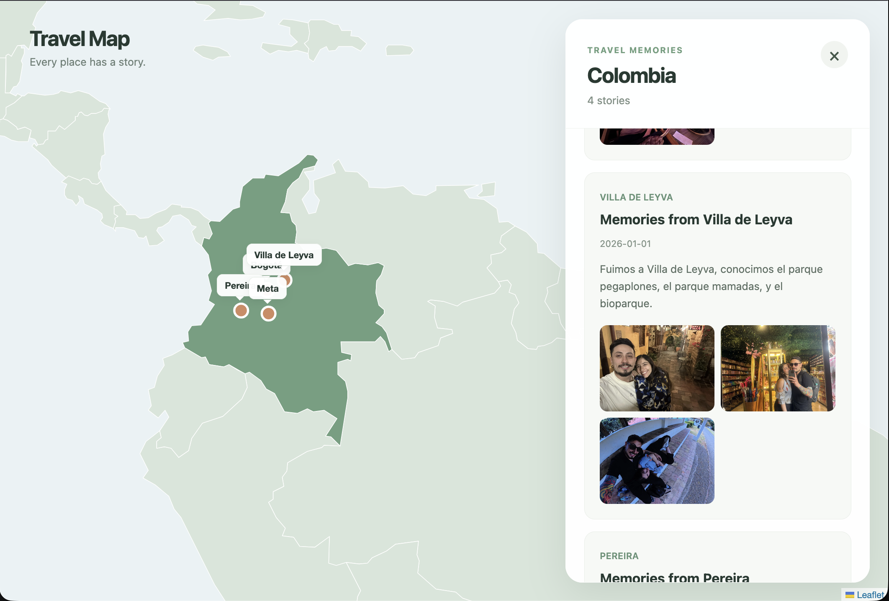

# v0.1.0 — First interactive prototype 🌍

> Release label proposed for documentation. Update the version/date to match the actual Git tag or deployment when publishing.

## What this version demonstrates

The first usable map-first journal: navigate a world map, explore countries with sample memories, choose a city marker, and browse stories and photos in a responsive interface.

## Screenshots

Add real screenshots to `docs/screenshots/v0.1.0/`, then uncomment the links below:

<!--  -->
<!--  -->
<!--  -->

Suggested captures: desktop world view (1440×900), desktop selected country (1440×900), and mobile sheet (393×852). Avoid including browser toolbars or private personal details.

## Engineering notes

- Static GeoJSON boundaries are drawn by Leaflet.
- React state coordinates country and trip selection.
- Local records and public assets keep the demo backend-free.
- Mobile uses a CSS-based expandable bottom sheet.

## Known limitations

- Content is hardcoded for demonstration purposes.
- There are no user accounts, direct uploads, or persistence.
- City markers represent trips; future versions may group visits by place.

## Next

Improve labels and place-level navigation, refine mobile UX, and add more robust testing.
